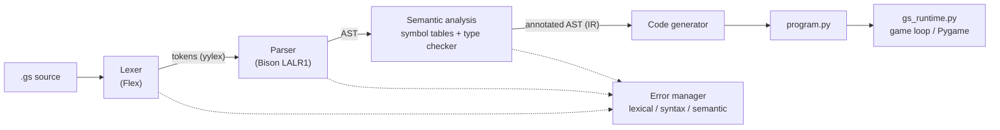

# GameScript Compiler — Architecture and Compilation Phases

## 1. Pipeline

```
                      ┌──────────────────────── gsc (C, Flex + Bison) ─────────────────────────┐
                      │                                                                         │
 program.gs ─chars─▶  │  LEXER ──tokens──▶ PARSER ──AST──▶ SEMANTIC ──typed AST──▶ CODEGEN     │ ──▶ program.py
                      │ lexer.l           parser.y        semantic.c   (IR)        codegen.c    │        │
                      │    │                 │                │                       │        │        │ imports
                      │    └──── lexical ────┴── syntax ──────┴──── semantic ──────────┘        │        ▼
                      │          errors           errors           errors / warnings            │  runtime/gs_runtime.py
                      │                      errors.c: line:col + source line + caret           │  (game loop, Pygame)
                      └─────────────────────────────────────────────────────────────────────────┘
```



Each phase runs only if the previous one produced **no errors**, because later phases
cannot trust a broken tree. Inside a phase, *all* errors are reported (the lexer skips a
bad lexeme, the parser resynchronizes at `;`, the semantic analyzer keeps checking).

| Phase | Input → Output | Source file(s) |
|-------|----------------|----------------|
| Lexical analysis | characters → tokens | `src/lexer/lexer.l`, `tokens.c` |
| Syntax analysis | tokens → AST | `src/parser/parser.y`, `src/ast/ast.{h,c}` |
| Semantic analysis | AST → annotated AST | `src/semantic/symtab.c`, `semantic.c` |
| Code generation | annotated AST → Python | `src/codegen/codegen.c` |
| Error management | (all phases) | `src/common/errors.{h,c}` |
| Driver | command line, phase orchestration | `src/main.c` |
| Runtime | generated Python → running game | `runtime/gs_runtime.py` |

## 2. Lexical analysis (`lexer.l`)

**Theory.** Every token class is a regular language, so it is described by a regular expression.
Flex compiles all expressions into one deterministic finite automaton and applies
*longest match, then first rule*. That is why `GAMEOVER` is an identifier although it starts with
the keyword `GAME`, and why keyword rules are listed before the identifier rule.

**Design.**
* Token codes are declared once, in `parser.y`; Bison generates `parser.tab.h`, shared by lexer and parser.
* Values travel in `yylval` (`int`, `double` or a heap string); positions in `yylloc`
  (1-based line/column), maintained by one hook, `YY_USER_ACTION`.
* A block comment is an *exclusive start condition*: inside it only comment rules apply.
* The lexer never stops at the first error. Dedicated rules give precise messages for `5.`, `.5`, `12abc`,
  `&&`, `||`, `!`, unterminated strings/comments, bad escapes, 32-bit overflow and non-ASCII characters.

```
$ gsc --tokens demo.gs                 1:1   KW_GAME
  1:6   ID           Demo              1:11  LBRACE
  2:10  ID           Player            3:32  INT_LIT      100  ...
```

## 3. Syntax analysis (`parser.y`)

**Theory.** The grammar (see `GRAMMAR.ebnf`) is context-free and parsed bottom-up (LALR(1)).
Each reduction runs an action that builds an AST node, so the parser's output is the tree, not just yes/no.

**Design.**
* **Precedence and associativity** are declared (`%left`, `%nonassoc`, `%precedence`) instead of writing one rule
  per level. Comparisons are `%nonassoc`: `a < b < c` is rejected.
* **Zero conflicts**: `access` and `call` share one `postfix` rule, so the automaton never has to guess early.
* **AST** (`ast.h`): `Expr`, `Stmt` and declaration nodes (`GameDecl → EntityDecl → Prop/FuncDecl/Event`, `Rule`).
  Lists are singly linked through `next`.
* **Error messages** use `%define parse.error custom`: we receive the unexpected token and the set of acceptable
  ones and produce text like `missing ';' before 'PRINT'` or `unexpected 'ENTITY', expecting 'GAME'`.
* **Recovery**: `statement : error ';'` resynchronizes after a bad statement, so several syntax errors appear in one run.

```
$ gsc --ast demo.gs
Game Demo
  Entity Player
    Property health : INTEGER
      Int 100
    On Collision With Enemy
      Assign
        Access health
        Binary -
          Access health
          Int 20
```

## 4. Semantic analysis (`symtab.c`, `semantic.c`)

**Theory.** Syntax cannot express "this name was declared" or "these operand types fit". Semantic analysis walks
the AST with a **symbol table** and a **type checker**, and *annotates* the tree.

**Symbol table** — a chain of scopes searched from innermost to outermost (inner names shadow outer ones):

```
global scope     entities, global functions
 └ entity scope  built-in `position`, properties, methods
    └ function / event scope   parameters, local variables
       └ block scopes          variables declared inside IF / WHILE bodies
```

**Two passes.** Pass 1 declares every entity, function, property and method, so forward references and recursion
work. Pass 2 checks bodies.

**Type checking.** `check_expr` returns a type and stores it in `Expr.type`. Result types follow the table in
`LANGUAGE_SPEC.md`; `TY_ERR` is accepted silently so one mistake does not produce a cascade of follow-ups.

**Annotations used later.** For each access path: where it starts (`B_LOCAL`, `B_SELF_PROP`, `B_ENTITY_PROP`), which
property, which vector component. For each call: which function and how to reach it (`C_GLOBAL`, `C_SELF_METHOD`,
`C_ENTITY_METHOD`).

**Other checks.** Return-path analysis (every path of a non-void function returns), game rules (`WIN` only in rules,
rules have no side effects, key names, duplicate handlers, `DESTROY SELF` in `ON DEATH`), constant division by zero,
and three warnings (unused variable, unreachable code, entity without events). Diagnostics are batched and printed
sorted by position.

## 5. Intermediate representation

The compiler's IR is the **type-annotated, name-resolved AST**. After semantic analysis every expression has a type and
every name points at what it denotes, so code generation needs no lookups, only printing. A separate linear IR
(three-address code) would add work without benefit for a source-to-source compiler whose target is a high-level language.

## 6. Code generation (`codegen.c`)

Target: **Python** on top of a small runtime. Generated names are prefixed to avoid clashes with Python keywords.

| GameScript | Python |
|------------|--------|
| `ENTITY Player` | `class E_Player(Entity)` |
| `PROPERTY health` | `self.p_health` |
| `position` | `self.position` (a `Vec2`) |
| `FUNCTION f` (global / in entity) | `def f_f(...)` / `def f_f(self, ...)` |
| `ON START` / `ON UPDATE` / `ON DEATH` | `on_start` / `on_update` / `on_death` |
| `ON COLLISION WITH Enemy` | `on_collision_Enemy(self, other)` + `COLLISIONS` table |
| `ON KEY_PRESS "SPACE"` | `on_key_SPACE(self)` + `KEYS` table |
| local variable `x` | `v_x` |
| `RULE R` | `def rule_R()` registered with `G.add_rule` |
| `MOVE UP BY n` | `self.move("UP", n)` |
| `SPAWN E AT v` / `DESTROY x` | `G.spawn(E_E, v)` / `G.destroy(x)` |
| `PRINT e` / `WIN` / `LOSE` | `G.print(e)` / `G.win()` / `G.lose()` |
| `AND OR NOT` | `and or not` |
| INTEGER → FLOAT widening | `float(...)` |

```python
class E_Player(Entity):
    NAME = "Player"
    COLLISIONS = {"Enemy": "on_collision_Enemy"}
    def __init__(self, game, pos=None):
        Entity.__init__(self, game, pos)
        self.p_health = 100
    def on_collision_Enemy(self, other):
        self.p_health = (self.p_health - 20)
```

**Runtime** (`runtime/gs_runtime.py`): `Vec2`, `Entity`, `Game` (entity list, edge-triggered collisions, rules,
win/lose state), a headless mode that prints a deterministic log (used by the tests) and a Pygame mode
(`--pygame`) that draws every entity as a labelled square.

## 7. Error management (`errors.c`)

* Three families, counted separately: **lexical**, **syntax**, **semantic** (plus warnings).
* Each message: `file:line:col: kind: text`, then the source line with a caret under the column.
* The driver ends with `compilation failed: 0 lexical, 1 syntax, 0 semantic error(s)` and exit status 1.

```
tests/semantic/type_mismatch.gs:10:15: semantic error: cannot assign FLOAT to 'count' of type INTEGER
        count = speed;
                ^
```

## 8. How the phases communicate

| From → To | Interface |
|-----------|-----------|
| Lexer → Parser | `int yylex(void)`, `yylval` (value), `yylloc` (position); token codes from `parser.tab.h` |
| Parser → Semantic | global `g_ast` (`GameDecl *`) |
| Semantic → Codegen | the same tree, now annotated (`Expr.type`, `base`, `prop`, `callee`, …) |
| Codegen → Runtime | a Python module that `from gs_runtime import *` |
| Any phase → user | `report_error / report_warning` (`errors.h`) |

## 9. Limitations and ideas for extension

* Runtime integers are Python integers (no 32-bit overflow); only literals are range-checked.
* Constant-zero division detection handles literal zeros only, not `1 / (1 - 1)`.
* Rules cannot assign or move directly, but may call functions (which could have side effects).
* Collision boxes are fixed 16×16; entities are drawn as coloured squares.
* The compiler does not free AST memory (short-lived process).
* Ideas: sprites, `VECTOR2` members assignable, `FOR` loops, arrays, constant folding, an optimizer over the typed AST,
  a bytecode VM target.
